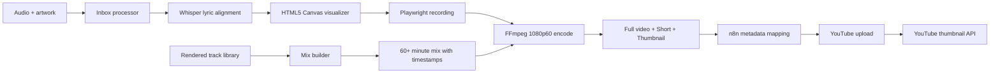

# Nightcore Automation Factory

A local-first media automation pipeline that turns an audio file and artwork into:

- a 1080p60 YouTube visualizer,
- a vertical short-form teaser,
- a generated thumbnail,
- timed lyric overlays,
- an optional one-hour music mix,
- structured metadata ready for automated YouTube publishing.

The project combines **n8n**, **Node.js**, **Playwright**, **FFmpeg**, **PowerShell** and
**OpenAI Whisper**. It was built to replace a repetitive manual publishing workflow with
an observable, recoverable and GPU-accelerated pipeline.

> This repository contains source code and sanitized configuration only. Songs, artwork,
> rendered videos and account credentials are intentionally excluded.

## Pipeline



## Highlights

- **Folder-based job queue** with stable-file checks and automatic audio/artwork pairing.
- **Dynamic visual theme** derived from the supplied background image.
- **GPU-first encoding** through NVIDIA NVENC with a `libx264` fallback.
- **60 FPS output** for both landscape and vertical formats.
- **Automated lyric transcription** and word-timestamp alignment using Whisper.
- **Multiple lyric inputs:** plain text, SRT, LRC and JSON.
- **Short-form rendering** with independently configurable start time and duration.
- **Mix generation** from previous renders or additional music libraries.
- **Automatic mix timestamps** for the YouTube description.
- **n8n-safe binary export area** for local files protected by n8n path restrictions.
- **Recovery utility** for publishing already-rendered jobs without rendering again.
- **Credential-free workflow export** that can be imported into another n8n instance.

## Technology

| Area | Technology |
| --- | --- |
| Workflow orchestration | n8n |
| Browser rendering | Playwright + Chromium |
| Video/audio processing | FFmpeg / FFprobe |
| Visualizer | HTML5 Canvas + Web Audio API |
| Automation scripts | Node.js, PowerShell |
| Lyrics | Python, PyTorch, OpenAI Whisper |
| Publishing | YouTube Data API v3 |

## Repository layout

```text
.
|-- n8n/                     Sanitized importable workflow
|-- examples/                Example mix configuration
|-- scripts/                 Render, queue, recovery and transcription tools
|-- templates/               Landscape, vertical and mix visualizers
|-- tools/                   Browser-based manual lyric timestamper
|-- metadata.template.json   Per-track defaults
|-- requirements-lyrics.txt  Optional Whisper dependency
`-- package.json             Playwright runtime
```

Runtime directories such as `inbox`, `queue`, `outputs` and `mix-outputs` are generated
locally and ignored by Git.

## Quick start on Windows

### Prerequisites

- Node.js 20 or newer
- PowerShell 7 or Windows PowerShell 5.1
- FFmpeg and FFprobe
- n8n (self-hosted)
- Python 3.10+ for optional lyric transcription
- An NVIDIA GPU is optional; CPU encoding is supported

### Install

The default scripts expect the repository at `C:\NightcoreFactory`. A different location
can be used through `NIGHTCORE_FACTORY_ROOT`.

```powershell
git clone https://github.com/Oliwier305/nightcore-automation-factory.git C:\NightcoreFactory
cd C:\NightcoreFactory

$env:NIGHTCORE_FACTORY_ROOT = "C:\NightcoreFactory"
$env:FFMPEG_PATH = "C:\ffmpeg\bin\ffmpeg.exe"
$env:FFPROBE_PATH = "C:\ffmpeg\bin\ffprobe.exe"

.\scripts\setup.ps1
```

For automatic lyrics:

```powershell
python -m pip install -r requirements-lyrics.txt
```

Install a CUDA-enabled PyTorch build appropriate for the local GPU before running large
Whisper models.

## Render a track

Place matching files in `inbox`:

```text
inbox/
|-- Example Song.wav
|-- Example Song.jpg
`-- Example Song.txt       optional reference lyrics
```

Then run:

```powershell
powershell -NoProfile -ExecutionPolicy Bypass -File .\scripts\process-inbox.ps1
```

Files with matching stems are paired automatically. When the inbox contains exactly one
audio file and one image, their names do not need to match.

The renderer creates:

```text
outputs/Example Song/
|-- Example Song.mp4
|-- Example Song-short.mp4
|-- Example Song-thumbnail.jpg
|-- Example Song-render-summary.json
`-- ...
```

## Metadata

Each queued project receives a copy of `metadata.template.json`. Useful options include:

```json
{
  "visualArtist": "Nightcore",
  "youtubeTitle": "Nightcore - Example Song",
  "accentColor": "auto",
  "lyricsAutoTranscribe": true,
  "lyricsWhisperModel": "base",
  "shortsEnabled": true,
  "shortStartSeconds": 45,
  "shortDurationSeconds": 30
}
```

`accentColor: "auto"` samples the artwork and applies a matching color to the visualizer,
thumbnail and text.

## n8n

1. Install n8n locally.
2. Start it through `scripts/start-n8n.ps1` so the workflow can access generated files.
3. Import `n8n/nightcore-workflow.example.json`.
4. Add a YouTube OAuth2 credential to both YouTube nodes.
5. Add a Google OAuth2 credential with the YouTube upload scope to the thumbnail request.
6. Keep uploads private while testing.

The workflow processes every rendered item returned by the inbox script, so multiple
audio/artwork pairs can be queued and handled in one execution.

## Build a long-form mix

Copy `examples/mix-config.example.json` to `mix-inbox/mix-config.json`, update the music
library and artwork paths, then run:

```powershell
powershell -NoProfile -ExecutionPolicy Bypass `
  -File .\scripts\build-mix.ps1 `
  -ConfigPath .\mix-inbox\mix-config.json `
  -Render true
```

The builder selects tracks, prepares transitions, creates a timeline, renders the mix and
generates YouTube description timestamps.

## Validation

```powershell
npm run check
```

GitHub Actions also validates JavaScript syntax, JSON files, Python compilation and
PowerShell parsing on each push and pull request.

## Design decisions

- Rendering remains local because large video files and GPU workloads are a poor fit for
  hosted automation runners.
- n8n orchestrates jobs and APIs while FFmpeg and Playwright perform media-heavy work.
- Uploads default to `private` to make failed metadata or visual checks non-destructive.
- Binary files are copied into an explicit n8n-accessible directory rather than disabling
  n8n file restrictions globally.
- Render summaries are persisted as JSON, enabling recovery and re-upload without another
  expensive render.

## Responsible use

Only process and publish media for which you have the necessary rights. See
[`NOTICE.md`](NOTICE.md) for repository media and platform-branding notes.
